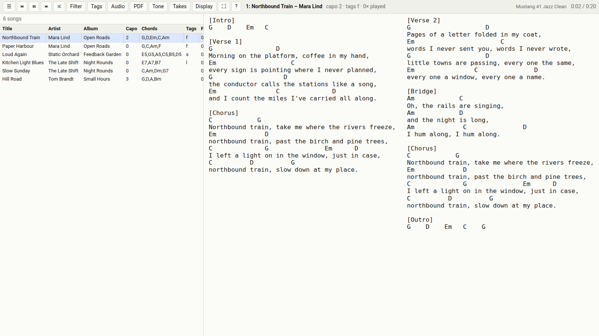
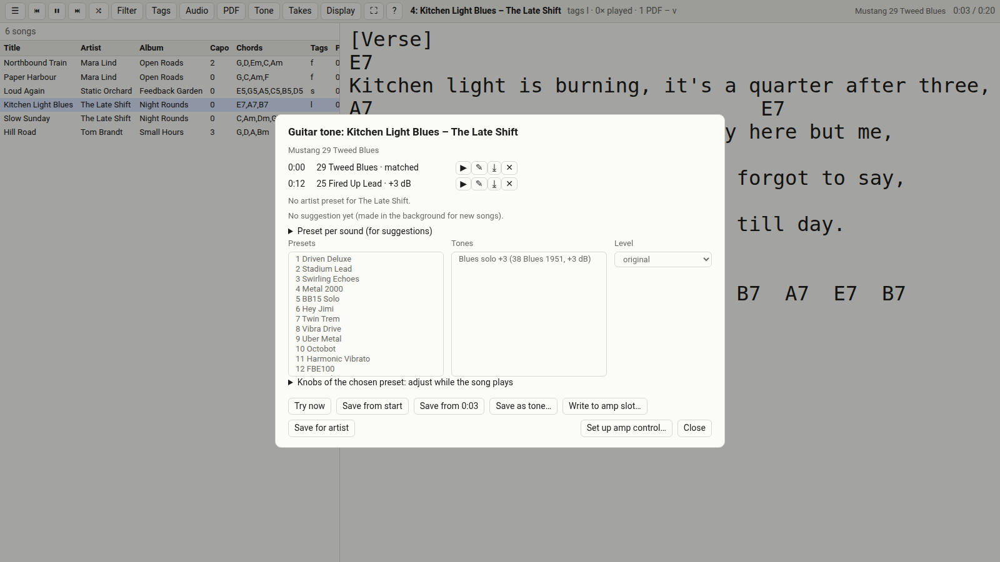
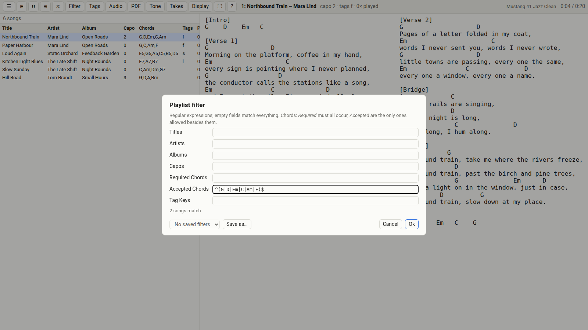
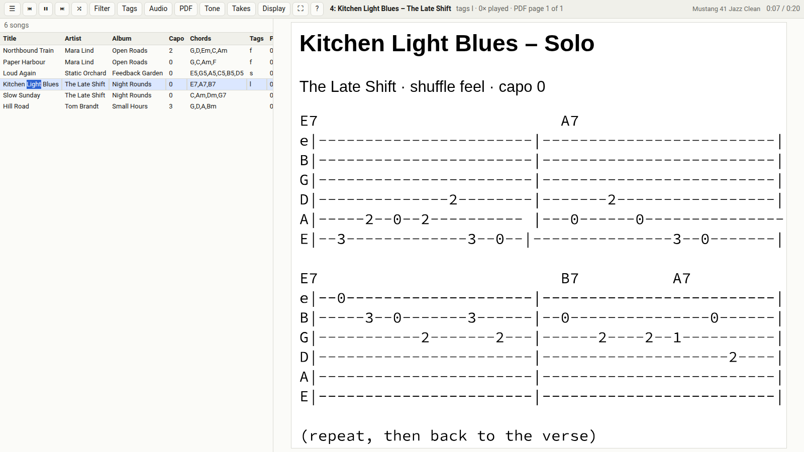
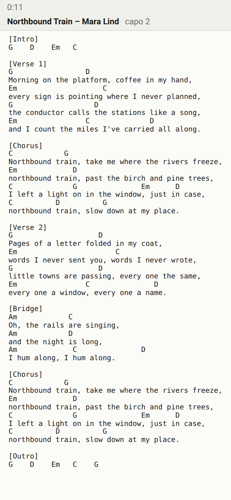
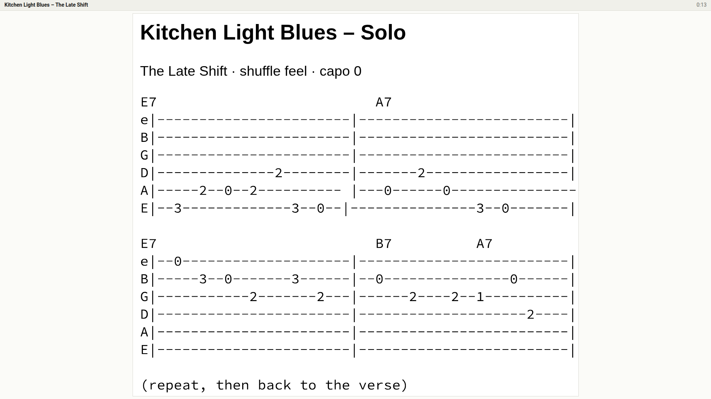

# ChordsPlay

Play your music collection in the browser while it shows each song's lyrics and guitar
chords, fetched automatically from Ultimate Guitar and drawn as large as the screen
allows. One server holds the songs, chords and history; any browser is the player.

## What it does

* Chords and lyrics of the playing song, as large as the screen allows; PDF tabs next to
  the song files instead of the text.
* Choosing what to play: filters by title, artist, capo, chords and tags; tags per user.
* The playing song on a TV, tablet or phone: a link or QR code, or a TV paired once.
* With a **Fender Mustang Micro Plus**: the amp switches to the preset or tone stored for
  the song, its artist or a part of the song; all presets equally loud; knobs per song;
  recording takes of song and guitar through the amp's USB.

Screenshots (made-up demo songs; the simulated amp shows Fender's factory preset names):

| | |
|---|---|
|  |  |
| Playlist and chords, as large as the screen allows | Guitar tone: a preset from the start, a louder one for the solo |
|  |  |
| Filter with a live count | A PDF tab next to the song, cropped |
|  |  |
| The song on a phone (display link) | The same on a TV, here with the PDF tab |

## Installing

Packages for openSUSE Tumbleweed and Leap, Arch and CachyOS, Debian and Raspberry Pi OS:
[docs/install.md](docs/install.md). The server needs only the music folders in its
settings; other devices reach it through a reverse proxy with a login.

## Documentation

| | |
|---|---|
| [docs/install.md](docs/install.md) | installing, updating, removing; from a checkout for developers |
| [docs/web.md](docs/web.md) | using and operating it: keys, filters, displays, PDF tabs, guitar tone, takes |
| [docs/spec-amp.md](docs/spec-amp.md) | how the amp control works |
| [docs/test.md](docs/test.md) | unit tests and tests with the amp |
| [docs/plans.md](docs/plans.md) | open points and ideas |

## Status

Version 1.5. In daily use on one server with one amp computer (CachyOS). Built and
installed in containers for every listed system; the Mustang parts are tested with the amp
on Arch/CachyOS, not yet on a Raspberry Pi. maneline's Micro Plus programs
(`maneline-mmp`) come from a fork until upstream maneline has them.

## What is where

| Path | What |
|---|---|
| `web/` | the server (`app.py`, Flask served by waitress) and the page (`static/`) |
| `ChordsPlay/` | shared modules: database (`db.py`), library scan (`scan.py`, `song.py`), Ultimate Guitar fetch (`chords.py`, `http.py`), text layout (`textfit.py`), amp logic (`amp.py`) |
| `mmp/` | the Mustang Micro Plus parts for the amp computer: the amp bridge (`bridge.py`), its units, level matching |
| `packaging/` | what the packages install (system unit, service user, settings file, `chordsplay` command, the Mustang parts' user units) and the package files for RPM, Arch and Debian |
| `contrib/` | install script for a checkout, settings template, Apache example |
| `tests/` | unit tests |

Try it from a checkout (Python 3.11 or newer):

```bash
git clone https://github.com/joba-1/ChordsPlay.git && cd ChordsPlay
python3 -m venv venv && venv/bin/pip install -r web/requirements.txt
CHORDSPLAY_MUSIC_DIRS=/path/to/your/music venv/bin/python -m web.app     # http://127.0.0.1:8616/
venv/bin/python -m unittest discover -s tests
```

## Licence

ChordsPlay is free software under the GNU Affero General Public License, version 3 or
later (`AGPL-3.0-or-later`): see [LICENSE](LICENSE). If you run a modified version for
others, they have the right to its source: the page's help carries a *Source* link, set
it with `CHORDSPLAY_SOURCE_URL`.

The bundled PDF viewer, [PDF.js](https://mozilla.github.io/pdf.js/)
(`web/static/vendor/pdfjs/`), is under the Apache License 2.0, see its `LICENSE` there.
