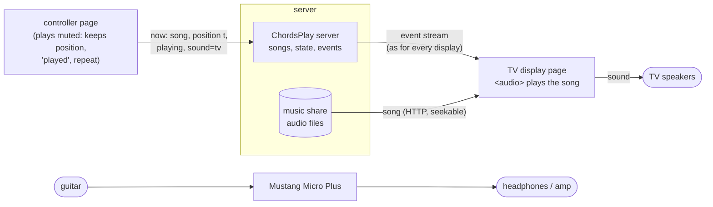

# Open points and ideas

Not promised; roughly in order of use.

## Mustang Micro Plus

* **maneline upstream:** done. The fork's Mustang Micro Plus changes went upstream as pull
  requests #154, #155, #157, #158 and #159 (backup/audition, level survey, save/restore/check,
  Linux without Bleak, the package `maneline`), all merged. The fork's own package is
  `maneline-joba1` (provides `maneline`, replaces the former `maneline-mmp`).
* **BlueZ older than 5.86** (Debian 13, Raspberry Pi OS 13 without the opt-in BlueZ):
  a fallback in maneline that brings up the control link with `Device1.Connect` while
  Bluetooth audio is connected. Shown to work; the cost: the control link stays up as
  long as audio does (no idle disconnect), and only one program can use it.
* **The opt-in BlueZ for Debian 13 / Raspberry Pi OS 13:** follow Debian's uploads until
  Debian 14 ships 5.86 or newer, then drop it. Test on a real Raspberry Pi.
* **Fender Tone and the agent:** can the phone app connect while the agent holds the
  link, or only while the agent sleeps?

## Practice mode

* **Bars and time signatures** for odd metres: beat_this's bar starts are wrong in Rush's
  metre changes, even with a Viterbi pass over common metres (see spec-practice.md,
  *Finding the beats*). Try models aimed at that (*Skip That Beat*, 2025; *Explore This!*,
  2026) when code and weights are out; then a count-in of "the bar before" with its stress.
  Seen at the Mustang in *Subdivisions* (2.1.6): most beats right, but where the beat moves
  by half a beat (the "and" becomes the beat) the tracker keeps the old phase for a while.
  A pass over an eighth-note grid that allows such a shift as a transition (as in the
  Viterbi experiment for metres) could follow it sooner.
* **Tap tempo for a section:** where the detected beats are wrong (the intro of
  *Subdivisions*: the clicks slower than the rhythm, the marks off the beat), tap the pulse
  a few times; the count-in and the snapping use it, kept with the section. Until then:
  the lead-in, which needs no beats.
* Per-song mixes on the server (per user), a mix per cue; removing old splits when the
  folder grows.

## Sound on the TV

Designed, not built. The device with this page plays the song, because it is the one paired with the
Mustang by Bluetooth; a display only shows. "Sound on the TV" would be a switch on the
controller (*Sound: here / on the TV*):

* The TV loads the same audio file as the controller (`d/tv/audio/<id>`, only the
  current song) and follows play/pause/song changes from the event stream. It computes
  where the controller is (`t` plus the time since `at`, corrected for the clock
  offset) and seeks when it is more than ~0.25 s off; the drift is small because both
  play the same file.
* The controller keeps playing, muted: its position stays the reference, and "played"
  and the repeat at the end work as before.
* Browsers start sound only after a key press on the device: the TV shows "Press OK to
  play the sound here" once.
* Consequences: the song no longer goes through the Mustang (you hear it from the TV, the
  guitar from the Mustang's headphones or an amp), and a take then holds only the
  guitar. The TV's delay (100–200 ms) doesn't matter, as with Bluetooth: the song isn't
  tied to the guitar's timing. Good for playing to the room or with friends; for
  practising with headphones the song through the Mustang stays better.
