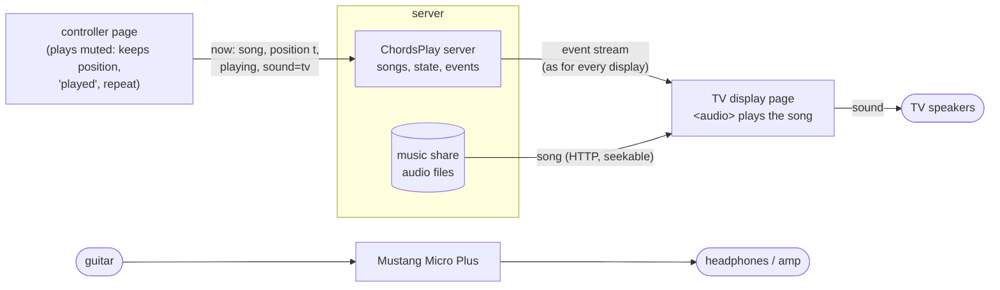

# Open points and ideas

Not promised; roughly in order of use.

## Mustang Micro Plus

* **maneline upstream:** offer the Micro Plus changes of the fork to upstream maneline as
  separate pull requests (Linux without Bleak, idle disconnect, backup/restore/audition/
  check/level tools, packaging). `maneline-mmp` is withdrawn once upstream ships the same.
* **BlueZ older than 5.86** (Debian 13, Raspberry Pi OS 13 without the opt-in BlueZ):
  a fallback in maneline that brings up the control link with `Device1.Connect` while
  Bluetooth audio is connected. Shown to work; the cost: the control link stays up as
  long as audio does (no idle disconnect), and only one program can use it.
* **The opt-in BlueZ for Debian 13 / Raspberry Pi OS 13:** follow Debian's uploads until
  Debian 14 ships 5.86 or newer, then drop it. Test on a real Raspberry Pi.
* **Fender Tone and the agent:** can the phone app connect while the agent holds the
  link, or only while the agent sleeps?

## Sound on the TV

Designed, not built. The device with this page plays the song, because it is the one paired with the
Mustang by Bluetooth; a display only shows. "Sound on the TV" would be a switch on the
controller (*Sound: here / on the TV*):

* The TV loads the same audio file as the controller (`d/tv/audio/<id>`, only the
  current song) and follows play/pause/song changes from the event stream. It computes
  where the controller is (`t` plus the time since `at`, corrected for the clock
  offset) and seeks when it is more than ~0.25 s off; the drift is small because both
  play the same file.
* The controller keeps playing, muted: its position stays the reference, and "played"
  and the repeat at the end work as before.
* Browsers start sound only after a key press on the device: the TV shows "Press OK to
  play the sound here" once.
* Consequences: the song no longer goes through the Mustang (you hear it from the TV, the
  guitar from the Mustang's headphones or an amp), and a take then holds only the
  guitar. The TV's delay (100–200 ms) doesn't matter, as with Bluetooth: the song isn't
  tied to the guitar's timing. Good for playing to the room or with friends; for
  practising with headphones the song through the Mustang stays better.
