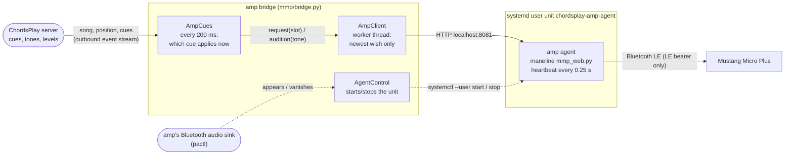

# Design: Mustang Micro Plus presets per song

How ChordsPlay switches a Fender Mustang Micro Plus: the amp agent, the amp bridge
(`mmp/bridge.py`) and the logic they share (`ChordsPlay/amp.py`: `AmpCues`, `AmpClient`,
`AgentControl`). Using it (the tone dialog, levels, knobs, writing an amp slot, takes) is
in [web.md](web.md). The design was first built into the former desktop app (3.34, tones
since 3.35) and moved into the bridge unchanged.

## Goal

When a song plays, the Fender Mustang Micro Plus switches to the tone stored for it, without a hand
on the amp. A song can have **several presets at different times**, for example a quiet acoustic
intro and a loud chorus. Storing a tone must be quick: set it on the amp, press one key.

## Architecture



The bridge and the agent run on the computer the amp is paired with. The bridge follows
the user's session on the server (which song, where in it) and feeds `AmpCues` from the
server's reply for the song (`SongPlan` in `mmp/bridge.py`).

* **ChordsPlay never speaks Bluetooth.** The amp agent is maneline's `mmp_web.py`, running as a
  systemd user unit. It owns the single LE connection to the amp.
  * **Why:** the amp needs a heartbeat at least every 0.5 s, and only one program may hold the link
    (with two subscribers BlueZ duplicates notifications and replies get garbled).
  * The connection should also outlive restarts of the bridge, because a reconnect costs about 3 s.
  * maneline already solves BlueZ LE-bearer control without dropping A2DP audio, plus reconnects,
    battery saving (`--idle-disconnect`) and single ownership. Re-implementing that would mean
    keeping a second copy of the same code.
* **HTTP over localhost** is the boundary:
  * `GET /api/micro-plus` returns the state;
  * `POST /api/micro-plus {"preset": n}` switches and waits for the amp's confirmation;
  * `POST /api/micro-plus/audition {"preset": {…}, "slot": 100}` plays a preset without
    saving it and `GET /api/micro-plus/preset?slot=n` reads a stored one (both for tones);
  * `POST /api/micro-plus/save` writes a slot. Only *Write to amp slot…* calls it.
  * The agent rejects a POST without a same-origin `Origin` header (protection against other web pages).
  * The client is not a browser, so it sends `Origin: <agent base URL>`.
* **Playback never waits for the amp.** Switching runs in the `AmpClient` worker thread.
  * Only the newest requested slot counts. If the agent is waking the amp (3–25 s) and the song
    moves on, the older request is dropped.
* **The agent runs only while it's useful.** `AgentControl` starts the unit when the amp's
  Bluetooth audio sink exists (amp on and connected to this computer) and stops it when the sink is gone.
  * **Why:** while the amp is off, the agent scans for it 10 s out of every 12 s.
  * It only stops a unit it started itself, so an agent started by hand is left alone.
  * **Cold start:** the first switch after the amp appears waits until the agent has connected
    (measured 3–8 s). After that the connection stays up while audio streams to the amp, and a
    switch takes 0.15–0.7 s (measured 2026-11-09).
  * **Idle:** after 5 minutes without a switch and without Bluetooth audio streaming, the agent
    drops the control link (`--idle-disconnect 300`); the next switch reconnects first (about
    3 s). The state then says `asleep`: the page shows "Mustang idle".
* **Cue writes vs. the scanner:** the library scan used to hold SQLite's write lock for 100 files
  at a time (seconds over NFS), which made storing a cue wait for about 3 s. The scan now commits
  at least every 0.2 s (`scan.py`, `COMMIT_INTERVAL`).

## Data model (SQLite, the server's database)

```sql
song_presets   (song_id → songs.id, start_ms ≥ 0, slot 1..100, slot_name,
                tone_id → tones.id, level_db, params, PK (song_id, start_ms))
artist_presets (artist PK, slot 1..100, slot_name, level_db, params)
tones          (id, name unique, base_slot 1..100, base_name, level_db, params, created)
preset_levels  (slot PK, name, correction_db, method, measured_at)
```

* A **cue** is `(start_ms, slot)`: from `start_ms` on, the song uses this slot.
* `slot_name` is the preset name at assignment time.
  * If the amp now has a different name in that slot (the preset was replaced in Fender Tone),
    the cue is **not** applied and a warning is shown.
  * **Why:** switching to a slot whose tone was changed is worse than not switching.
  * Saving the cue again accepts the new name.
* `tone_id`: the cue plays a tone instead of the plain slot (see "Tones" below).
* `level_db` and `params` on a cue or an artist preset: level "original" (NULL) or
  level-matched plus an offset, and knobs per cue. The server hands such a cue to the bridge
  as a tone of its own.
* No user column: the amp's slots belong to one physical amp, not to a ChordsPlay user.

## Which slot plays when

1. `cues` = the song's cues, ordered by `start_ms`.
2. `base` = the artist's slot, else a suggested preset (if switched on), else
   `AMP_DEFAULT_SLOT` of the bridge, else none.
3. If there's a base and no cue at 0 ms, the base becomes the cue at 0 ms.
4. Every 200 ms the active cue is the last one with `start_ms - lead_ms <= position`.
   * `lead_ms` (default 300) makes up for the 0.1–0.6 s a switch takes while connected.
5. When the active cue `(song, index)` changes, the cue's slot is requested.
   * Seeking backwards, restarting a song (the player repeats a song when it ends) or skipping
     all switch correctly, because the active cue is always derived from the position.
6. No cue applies → the amp is left as it is.

## Keys and settings

The page's keys are in [web.md](web.md): `g` opens the tone dialog, `G` learns the amp's
**current** slot as a cue for the playing song (at 0 if the position is under 3 s,
otherwise at the current position; needs a connected agent: while it's asleep, a preset
changed with the amp's buttons isn't known).

The bridge's settings (`~/.config/chordsplay/bridge.env`):

| Variable | Default | Meaning |
|---|---|---|
| `CHORDSPLAY_BRIDGE_URL` | (required) | the line from the page's tone dialog, *Set up amp control…* |
| `AMP_URL` | `http://localhost:8081` (or the agent's `AMP_AGENT_PORT`) | agent base URL |
| `AMP_UNIT` | `chordsplay-amp-agent.service` | systemd user unit to start/stop; empty: don't manage |
| `AMP_SINK` | `Mustang Micro Plus` | text in the audio sink's description that means "amp is connected" |
| `AMP_DEFAULT_SLOT` | (unset) | slot for songs without cues, artist slot or suggestion |
| `AMP_LEAD_MS` | `300` | switch this many ms before a cue |

Slot 100 is reserved for tones (auditions) and never offered as a normal preset.

## Security

* The agent listens on port 8081 (or `AMP_AGENT_PORT` from `~/.config/chordsplay/amp-agent.env`,
  written by the installer's `AMP_PORT`) on all interfaces. Its host check allows only localhost and
  this machine's hostname, and its Origin check blocks other web pages.
* The bridge talks to the agent on `localhost` only and validates the replies. It needs no open
  port itself: it connects out to the server, and its token (in the link from the page's tone
  dialog, stored on the server only as a hash) is its only key.
* Slot numbers are validated in the DB (`CHECK`) and in the client (1–100).

## Tones: audition fiddling (added 2026-11-10)

A **tone** is a base preset (a slot), a **level offset** in dB, and **knob settings**:
amp gain/bass/mid/treble/presence, and per effect block on/off, mix, depth, decay
and feedback.
* **Stored in ChordsPlay** (table `tones`), not on the amp.
* **A cue can play a tone** (`song_presets.tone_id`). The bridge then builds the
  preset JSON and sends it to the agent's audition endpoint, which plays it on the
  live slot (100).
* **Nothing is written to the amp's preset memory,** so there is no flash wear on an
  everyday task. A power cycle forgets the audition.

**Why audition instead of saving presets:**
* Unlimited tones per song.
* Your 100 slots and their names stay untouched.
* Variants such as "80S Rock +3 dB" cost nothing.

**Building the preset JSON** (`amp.build_tone`):
1. Fetch the base preset from the agent (`GET /api/micro-plus/preset?slot=n`); it
   is cached until the agent reconnects.
2. Add a measured level correction for the base slot (table `preset_levels`, see
   below) plus the tone's level offset to the amp volume.
3. Apply the knob settings and name it after the tone.

The cue logic waits for the base preset before it marks a tone cue as applied, so
the first tone after start-up comes a moment later.

**The client** (`AmpClient`) treats slots and tones alike:
* The newest wish wins, and a superseded one is never sent.
* A tone whose content is already playing is not sent again (key = hash of the JSON).
* Selecting a real slot ends the audition.

**In the page's tone dialog:** the level next to the presets (*original*, or matched plus
−6 … +6 dB), the knobs with *Play while adjusting*, and *Save as tone…* (see web.md).

**Level matching across presets** (`preset_levels`, imported from maneline's
`mmp_level.py survey`):
* Only corrections measured with a playing-level signal at the guitar input are used:
  the **signal** method (a test tone through a cable) or the **played** method (you play
  the same riff for every preset). The corrections in use since 2026-11-10 were
  measured with the played method; the signal method is built but not yet run with a
  cable.
* The **noise** method (guitar connected at volume zero, gate off) is exact for level
  *changes* within a preset. But it is wrong across presets: on the 71 factory
  presets it spans 59 dB, because noise doesn't drive distortion and compressors like
  a guitar does. So noise corrections are stored but ignored.
* Measuring with the signal method needs an adapter cable (3.5 mm plug to 6.35 mm
  socket) from the computer's headphone output to the amp's plug. See maneline's
  `docs/MUSTANG_MICRO_PLUS_LEVELS.md`.
* A survey (`<backup>/levels-signal.json` or `levels-played.json`) reaches the server
  over the bridge's link: `python3 -m mmp.bridge levels FILE` on the amp computer, which
  `mmp/match-preset-levels.sh` does at its end; or `python -m web.presets levels FILE`
  on the server. A noise survey is stored but not used.
* **Played method (no cable):** `PLAYED=1 mmp/match-preset-levels.sh`. For every
  preset you play the same short riff when prompted, and the level of its loudest half
  of 100 ms frames is measured, so pauses don't count. It is about ±1 dB from take to
  take. The noise floor is measured once with muted strings; a first take less than
  15 dB above it aborts the run.
* **In sessions:** Enter pauses after the current preset (amp connected); Enter again
  goes on with the practice takes and starts a new session. Every measured preset is saved at once in
  `<backup>/survey-<method>.json`, so Ctrl+C loses at most the preset being played. The
  script remembers the unfinished backup in `~/.local/share/chordsplay/levels/current-<method>`
  and goes on with it (`FRESH=1` starts over). A new session first measures the last
  `OVERLAP` presets (default 2) again; their mean difference to last time is that
  session's offset and is taken off all its levels, so every session is on the scale of
  the first. If the repeats disagree by more than 1.5 dB the script suggests stopping and
  warming up. The levels are sent only when every preset is measured.
* **One step, once the cable is there:** `mmp/match-preset-levels.sh` backs up the
  presets, measures every slot 1–99 with the test tone (headphone output at a fixed
  40%), and sends the corrections.
  * The measurement aborts before writing anything if the tone doesn't arrive (less
    than 15 dB above the amp's level without it).
  * A dry run without the cable on 2026-11-10 stopped there as intended.
* **No software-only alternative:** a fuzz at full gain in front of the amp lifts the
  input noise by only 9–27 dB, far from playing level. USB and Bluetooth playback don't
  pass the amp model.

**Verified 2026-11-10 on the amp:**
* Tones built by ChordsPlay from 80S Rock at +3/+6/−3/−6 dB measured +2.9/+5.8/−3.0/−5.8
  dB at the amp's USB output (`mmp/manual_tone_level_test.py`).

## Agent installation

`mmp/install-amp-agent.sh` installs the agent:
* clones maneline (fork `joba-1/maneline`, branch `micro-plus-preset-backup`: Linux LE
  bearer, idle disconnect, audition, stored-preset and save API, `mmp_backup.py`,
  `mmp_level.py`, `mmp_restore.py`, `mmp_check.py`) to `~/.local/share/chordsplay/maneline`;
  `MANELINE_REPO` may be a local checkout. Run it again to update an older install
* creates a venv with pinned `dbus-fast`
* installs the user unit `chordsplay-amp-agent.service` (not enabled: the bridge starts it)

Then `mmp/install-amp-bridge.sh` installs the bridge (web.md, "Guitar tone").

One-time BlueZ setup (`Experimental = true`, LE pairing): maneline's
`docs/MUSTANG_MICRO_PLUS_LINUX.md`. The fuller version (requirements, pairing from
scratch) is on the fork's branch `micro-plus-linux-setup`, not in the installed one.

## Open points

* ~~Does the amp report a preset chosen with its own buttons while connected?~~ Yes (tested 2026-11-09):
  the ◀ marker in the tone dialog follows, so `G` also learns presets set on the amp.
* Can Fender Tone connect while the agent holds the link, or only while the agent sleeps?
