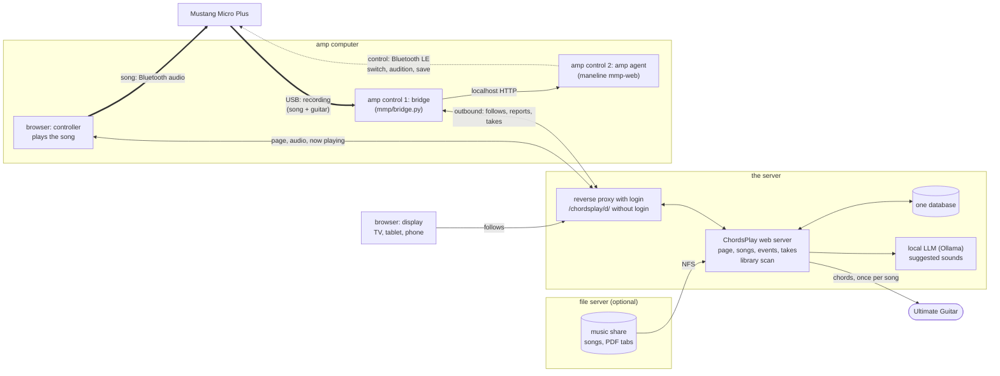

# ChordsPlay: using and operating it

ChordsPlay in the browser. The examples assume it is published by a reverse proxy at
`https://example.org/chordsplay/`, behind a login (see "Operating it"); on the server
itself it is `http://127.0.0.1:8616/`. The page's own help (`?`) says the same as the
first sections here, in short.

## What you need for what

* **With any speaker, headphones or amp:** playing the songs, the chords as large as the
  screen allows, PDF tabs, choosing songs (filter), tags, the song on a TV, tablet or
  second screen. The sound comes out of the device the page runs on, so connect that to
  whatever you play through: headphones, a speaker, the AUX input of an amp, or a
  Mustang Micro Plus by Bluetooth.
* **Only with a Fender Mustang Micro Plus:** the guitar sound changing by itself per song
  (and within a song), equal loudness of all sounds, adjusting effects, keeping a sound
  in the amp, recording takes. For these, the computer the Mustang is connected to runs
  *amp control* (the amp bridge, set up once; see "Guitar tone").
* **With a separate guitar amp:** everything in the first point works; the guitar sound
  is set on that amp, ChordsPlay doesn't change it.
* **On another screen (TV, tablet, laptop):** only a browser. A link or QR code from `d`,
  or for your own TV a bookmark paired once (see "A TV or tablet as display").

## Using it

The page shows the playlist on the left, the song's chords and
lyrics on the right, as large as the window allows (1–4 columns). The browser plays the
song, so connect the Mustang (or any output) to the device the browser runs on.

Most of it is keyboard-driven:

| Key | Action |
|---|---|
| Space, m | play / pause |
| Enter, n | next song |
| Backspace, p | previous song |
| 0 | back to the start of the song |
| + / −, → / ← | 1 s / 5 s forward or back |
| s | shuffle the playlist |
| f | filter dialog: choose what to play (see below) |
| t | tags of the song; press a tag's key to switch it |
| l | show or hide the playlist |
| a / A | choose / switch the audio output (browsers with output selection, e.g. Chrome) |
| d | show the song on a TV or tablet (display link, see below) |
| v / V | the song's text or one of its PDF tabs (cycles) / all PDFs and their songs |
| Page Down / Up | turn the PDF's pages |
| g | guitar tone: the amp's presets for this song (see below) |
| G | learn: the amp's current preset from here on (in the first 3 s: from the start) |
| r / R | record a take through the amp's USB / the song's takes (see below) |
| F11 | full screen |
| ? | key overview |

Double-click a song in the list to play it; click a column heading to sort. The thin line
under the top bar shows where the song is; click or drag it to go there (it shows the time
under the mouse).
A song repeats until you go on, and each time it ends it counts as played. The page remembers the song you were at, on every device: after a reload
press Space to go on. Hardware media keys and Bluetooth headset buttons work too
(play/pause, next, previous).

Browsers need one key press or tap before they play sound; after a reload the page
shows "Press Space to play".

**Long comment lines.** Chord sheets often carry comments in long lines ("Note: the
recorded version is 30 cents sharp ..."), and the widest line decides the font size.
The page shows such lines wrapped to the width of the song text whenever that makes the
text larger. Chord lines, the lines under them and tab lines are never changed, and
lines no longer than 90 % of the song's lines stay whole. Heuristic:
`ChordsPlay/textfit.py`.

## Filter and tags

**Filter (`f`).** Every field is a Python regular expression (empty matches anything);
the dialog shows how many songs match while you type.

| Field | Matches against |
|---|---|
| Titles, Artists, Albums | the song's title, artist, album |
| Capos | the capo fret as text (`0` for no capo, `3` for capo 3) |
| Required Chords | every chord listed here must be in the song |
| Accepted Chords | the song may use only these chords (with Required: only required + accepted) |
| Tag Keys | a tag's key (`f` for favourites, `[fl]` for favourite or easy) |

Example, songs without a capo that use only easy chords: Capos `^0$`, Accepted Chords
`^(C|D|E|G|Am|Em)$`. A filter can be saved under a name and loaded again; the one last
applied is kept as `__previous`.

**Tags (`t`).** Each tag has a key; pressing it switches the tag for the playing song.
The tags are per user:

| Key | Name | Meaning |
|---|---|---|
| `f` | Favorit | favourite |
| `s` | Schwer | hard to play |
| `l` | Leicht | easy to play |
| `u` | Unfertig | incomplete tab |
| `c` | Capo | needs a capo |
| `x` | Fixiert | **locked**: the scanner never fetches this song's text again |

Without the lock, the scanner looks a song up again about once a month. Lock a song once
its text is the one you want to keep, or to stop the scanner asking for a song Ultimate
Guitar doesn't have.

## A TV or tablet as display

Press `d` (or *Display*). The dialog shows a link, its QR code and the short code in it.
Open the link on the TV's browser, a tablet on the music stand or a second screen: it
shows the song this page plays, as large as that screen allows, with its title, capo
and the time in the song, and follows every change within about a second. Click it,
or press Enter or OK on the remote, for full screen (a paired TV: its ⛶ button, see
below); it keeps the screen on.

* The display plays no sound and can change nothing; the audio stays on the controller
  (the device paired with the Mustang).
* A link is valid for 12 hours. *End all display links* stops every open display at once.
* Several displays can follow the same controller.
* The display follows the user, not the browser tab: whatever page of yours plays last
  is what the displays show.
* The display needs no login (a TV, a friend's TV): the code in the link is the key.
  Everything else under `/chordsplay/` still needs the login.
* **Your own TV, paired once:** open `https://example.org/chordsplay/d/tv/`
  on it and keep it as a bookmark. It shows a code: enter it with `d` under *Pair a TV*.
  The TV then keeps a token as a cookie and follows you whenever the bookmark is
  opened, no new link needed. *Pair a TV* lists the paired TVs; ✕ removes one (it has
  to pair again). A code is valid for 10 minutes and can only be approved by the
  logged-in page.
* **Remote from a paired TV** (not from a code link): OK (a click or tap) anywhere on the
  page shows big buttons ⏮ ⏯ ⏭ ⛶ at the bottom for 15 s, OK on the page again hides them;
  OK on a button steps through the playlist, pauses, or switches full screen. Made for TV
  Bro, whose cursor tells the page nothing while it moves. Where the keys reach the page
  (TV Bro's direct navigation mode, left with a long press of Back; other browsers):
  ← → previous/next, OK play/pause, ↑ ↓ show the buttons, the media keys. The command goes to the controller page that played
  last, which does it (it plays the sound), so cues and the displays follow as usual.

## Takes: recording yourself

`r` records a take of the playing song through the amp's USB output (stereo, 24 bit,
48 kHz, as the amp sends it), `r` again stops it; the top right shows `● REC 0:12`.
The amp bridge records on the computer the amp is connected to by USB, compresses
the take to Opus (192 kbit/s, about 4 MB for 3 minutes) and sends it to the server
(`/var/lib/chordsplay/takes`, `CHORDSPLAY_TAKES_DIR`). `R` (or *Takes*) lists
the song's takes: ▶ plays one, ✕ deletes it. A take holds the **whole mix**: the amp
mixes the song arriving over Bluetooth into its USB output (measured: −92.5 dBFS with
nothing playing, −41 dBFS with a song and the strings quiet). A take nobody stops ends after 20 minutes.

## PDF tabs

A song can show a PDF (a tab printed from Ultimate Guitar, your own sheet) instead of
its text, as large as the screen allows: the white margins and a browser's print
header and footer are cropped, and two pages stand side by side when they are nearly
as large as one alone.

* `v` cycles through the song's text and its PDFs; the choice is kept per song.
  *Page Down* / *Page Up* turn the pages; the title shows which pages you see.
* A display (key `d`) shows the same PDF and pages as the controller.
* **Where a tab belongs: next to its song**, like a hand-saved song text, with the song
  file's name and `.pdf`: `13 Cruz.mp3` → `13 Cruz.pdf`. A part goes after ` - `:
  `13 Cruz - Solo.pdf`. The library folders are always scanned for these.
* Other folders on the server (`CHORDSPLAY_PDF_DIRS`, default `/var/lib/chordsplay/pdf`):
  there a file named `Artist - Title.pdf` or
  `Artist - Title - Part.pdf` (`Queen - Hammer To Fall - Solo 1.pdf`) links itself to its
  song; case, punctuation and a leading "The" don't matter. `V` (or *PDF*) lists all PDFs: choose the song for one that didn't link
  itself, or mark it as no song's tab. A choice by hand is never changed by a later
  scan. The folders are scanned at start, every 24 hours and when `V` opens.

## Guitar tone (Mustang Micro Plus)

A song can switch the amp's preset at set times (cues): a quiet
intro, a loud chorus. Cues, artist presets and tones are in the central database, so
every device plays them.

* `g` (or *Tone*, or the amp status at the top right): the song's cues, the amp's 100
  presets (◀ = the current one) and the saved tones. *Try now* switches the amp without
  storing anything; *Save from start*, *Save as new cue at m:ss.cc* and *Save for artist*
  store it. ▶ plays a cue from a little before it, ✕ deletes it.
* **Placing a cue exactly:** the editor under the cues shows the song's waveform around a
  position (window 2 to 30 s; light: peaks, dark: loudness), so the start of a loud part
  or a pause is easy to see. Set the position by clicking into the waveform, dragging it
  or the mouse wheel, the slider over the whole song, the steps (±1 s, ±0.1 s, ±0.01 s;
  with the waveform focused also ← → with Shift or Alt), by typing `m:ss.cc`, or with
  *Now* (where the song is). With *follow the song* the waveform stays centred on where the
  song is and scrolls while it plays (dragging or the wheel switches it off). *▶ Around* plays from 1–8 s before the position to 2 s
  after it and pauses; *▶ On* keeps playing. Put a cue where the part starts as you hear
  it: the timing is set for a song played to the amp over Bluetooth, so the new sound
  starts at that moment (measured: within about ±50 ms).
* **Changing a cue:** ✎ in its row puts its position and sound into the editor (the row is
  highlighted). Move the position, change preset, level or knobs (or choose a tone), then
  *Update cue* stores both; ⤓ stores only the sound. *New cue instead* leaves the cue as
  it is and makes the position one for a new cue.
* **Level** (next to the presets): *original* plays the preset as stored in the amp. A
  number plays it **level-matched**: with the correction from your level measurement
  (`chordsplay-match-levels`, see below), so every preset at *matched* (0 dB) is equally
  loud, plus −6 … +6 dB (e.g. +3 for a solo). It is stored with the cue, the artist
  preset and the preset per sound, and used by *Try now*. Level-matched presets play
  by audition on slot 100 (nothing is written to the amp); a preset that wasn't
  measured plays at its own volume plus the offset.
* **Knobs** (fold out under the presets): the chosen preset's amp gain and EQ, and per
  effect on/off, mix, depth, decay, feedback. With *Play while adjusting* every change
  is heard at once (by audition, nothing written to the amp). *Save …* stores the
  knobs with the cue or the artist, together with the level; ✎ in a cue's row loads
  it for changing, ⤓ stores the current choice into that cue. With *original* the
  preset keeps its own volume. The server knows each slot's preset from a backup
  (`chordsplay presets import BACKUP_DIR`) and asks the bridge to read a slot again
  when the amp's name for it changed.
* **Keep a tuned sound:** *Save as tone…* names it (preset, level, knobs); it is then in
  the *Tones* list for any song. *Write to amp slot…* writes it into a free slot of the
  amp (72–99), so the amp's own buttons call it up too: built exactly as it is heard by
  audition, read back after writing. The factory presets (1–71) and slot 100 (used for
  auditions) are never written. `mmp-restore` (maneline) puts slots back from a backup.
* `G`: stores the preset the amp has now (chosen with its own buttons, say) from here on.
* The switching itself is done by the **amp bridge** on the computer the amp is paired
  with. It needs no open port: like a display it follows your session from outside.
  Set it up once on that computer as described in [install.md](install.md), "The
  Mustang parts": the package `chordsplay-mmp`, the one-time Bluetooth setup, and the
  line from `g` → *Set up amp control…* in `~/.config/chordsplay/bridge.env`. The bridge
  starts the amp agent while the amp is connected. Making a new line ends the previous one.
* **The song through the Mustang:** the tone dialog says where the song goes, as the bridge
  sees it on the amp computer, and *Play through the Mustang* has the bridge connect the
  amp's Bluetooth audio if needed and move the browser's sound there (PipeWire; all of the
  browser's tabs, since a browser plays through one stream). *always* does that whenever a
  song plays and the browser on the amp computer doesn't play to the Mustang. It works for
  a browser on the amp computer only; the top right adds `♪ via Mustang` or
  `♪ not via Mustang`.
* The top right shows what the bridge reports: `Mustang 19 80S Rock`, `Mustang ▶ <tone>`,
  `Mustang idle · 19 80S Rock`, `Mustang not connected`, or `amp control off` (nothing
  heard from the bridge for 30 s). *Idle*: after 5 minutes without a switch **and with no
  Bluetooth audio streaming to the amp**, the agent drops the Bluetooth control link to
  save the amp's battery; the next switch wakes the link, which takes a few seconds
  (measured 2.7–3.4 s, once 14 s). While a song streams over Bluetooth the link stays
  up, so switches within a song are not delayed. With the song on USB instead, the
  agent sees no stream and can go idle during a long song.
* **Suggested presets** for songs with no preset of their own and none for their artist:
  a local LLM (Ollama, `CHORDSPLAY_OLLAMA_URL`; without one there are no suggestions)
  puts each song into a sound (clean, crunch, hard rock, …; with
  the artist's genres from MusicBrainz as a hint) and says whether it knows the song.
  Suggestions are **only shown** until you tick *Play suggestions automatically* (under
  *Preset per sound*): the model claims to know nearly every song (98 % in a test,
  album tracks of German singers included), so set the presets by ear first. Then songs
  it "knows" are switched; guesses never are. `g` shows the suggestion,
  with *Use from start* (store it as the song's own) and *Reject*. Under *Preset per
  sound* you set which preset each sound plays: the table starts as a draft by preset
  names and is meant to be set by ear. New songs get a suggestion after each library
  scan. Order when a song plays: its own cues,
  the artist's preset, the suggestion, `AMP_DEFAULT_SLOT` of the bridge.
* The bridge switches only while a song plays.
* **The same level for every preset:** on the amp computer, with the bridge and the agent
  stopped (`systemctl --user stop chordsplay-amp-bridge chordsplay-amp-agent`; the
  command says so), run `chordsplay-match-levels` (from a checkout:
  `mmp/match-preset-levels.sh`) in one of two ways:
  * **With a cable:** connect the computer's headphone output to the amp's plug with an
    adapter cable (3.5 mm stereo plug to 6.35 mm socket). The script measures every
    preset with a test tone (about 5 s each).
  * **Without a cable:** `PLAYED=1 chordsplay-match-levels`. You play the same short
    riff for every preset when prompted (4 s each, about ±1 dB).
  * **Pause any time** with Enter (after the current preset); Enter again goes on, with
    the practice takes first. **Stop** with Ctrl+C and run the same command again later:
    it goes on where it stopped. After a pause or a stop it first has you play the last
    2 presets of last time again (`OVERLAP=1` for one) and takes the difference in your
    playing off the new levels. `FRESH=1` starts over.
  * Once every preset is measured, the script sends the corrections to the server over
    the bridge's link. Start the bridge again afterwards.
  * Without that measurement, level-matched presets play at Fender's own factory levels
    plus the offset.

## How it works

### What runs where, and why



* **Server:** one database for every device; scans the library, fetches chords,
  serves the page, the audio and the PDFs.
* **Controller:** any browser; with the Mustang it is the device paired with it, because
  the device that plays must send the sound to the Mustang.
* **Display:** any browser; shows only, needs no login (a link with a code, or a TV
  paired once).
* **Amp control** is two programs on the amp computer. The **amp agent** (maneline) holds
  the Mustang's single control connection, which needs a heartbeat at least every 0.5 s
  (the agent sends one every 0.25 s): only a program that always runs can do that, not
  a browser tab.
  The **bridge** (ChordsPlay) connects the agent with the web app: it follows your song
  from the server and tells the agent what to play, without an open port (it connects
  out, like a display), and records takes from the Mustang's USB.

Addresses: the browser talks to the reverse proxy (Apache in the example) on port 443
under `/chordsplay/` (with a login, except `/chordsplay/d/`), which passes it on to
`web/app.py` on `127.0.0.1:8616`. The database is `/var/lib/chordsplay/chordsplay.db`
(checkout install: `~/.local/share/chordsplay-web/chordsplay.db`); the music is in the
folders of `CHORDSPLAY_MUSIC_DIRS`, local or a network share.

* `web/app.py` (Flask, served by waitress): JSON API, the page (`web/static/`), the audio
  files with range requests. All queries go through `ChordsPlay/db.py`.
* One database for all devices: play history, tags, filters and the playlist order
  are the same everywhere. Besides the tables of `ChordsPlay/db.py` it has the web app's own:
  `web_state` (per user: the current song, *Play suggestions automatically*),
  `display_codes`, `tv_devices`/`tv_pairings`, `bridge_tokens`, `takes`, the PDF tables
  (`web/pdfs.py`), `amp_presets` (`web/presets.py`) and the suggestion tables
  (`web/suggest.py`).
* The library scan and the Ultimate Guitar fetch run in the server (`ChordsPlay/scan.py`),
  at start and every 24 hours.
* User: the proxy passes the login name as `X-Remote-User` (and drops what a client
  sends). Requests through the proxy without a login are refused. Direct requests on the server
  (`curl 127.0.0.1:8616`) use `CHORDSPLAY_USER`.
* Following: the controller reports song, position and play/pause (`PUT api/now`, at
  every change and every 15 s while playing). The server keeps the latest state per user
  in memory (and the song in `web_state`) and pushes it as server-sent events to
  `api/events` and `d/<code>/events`.
* Amp bridge (`mmp/bridge.py`, standard library plus `ChordsPlay/amp.py`): follows
  `d/bridge/<token>/events` (song and position; `plan` when cues were edited; `cmd` for
  *Try now*, reading a slot for the knobs, writing an amp slot, starting and stopping a
  take), fetches the song's cues (`d/bridge/<token>/song/<id>`), picks the cue
  (`AmpCues`, timed for the song's delay over Bluetooth, `AMP_LEAD_MS`) and switches or auditions through
  the agent (`AmpClient`). It reports the amp's state every 10 s or on a change
  (`PUT d/bridge/<token>/amp`), which the controller pages get as `amp` events, and
  uploads what the server asked for (`PUT …/preset/<slot>`, `PUT …/take/<id>`). The
  token is stored only as a hash (table `bridge_tokens`, one per user).
* Display codes are in the table `display_codes` (10 characters from a 31-letter
  alphabet, ~49 bits; an unknown code costs a 1 s wait). A paired TV (`d/tv/`) shows a
  6-character code for 10 minutes; once the logged-in page approves it, the TV gets a
  random token as an HttpOnly cookie for `/chordsplay/d/tv` (kept 3 years, only its
  hash stored in `tv_devices`).
* Audio is read from the music folders directly: the scanner needs the files anyway
  (tags). A network share that is mounted late at boot: see [install.md](install.md).

## Operating it

| What | How |
|---|---|
| Install, update, remove | [install.md](install.md) |
| Settings | `/etc/chordsplay/chordsplay.env` (checkout install: `~/.config/chordsplay/web.env`); every setting with its default: `contrib/chordsplay.env.example`. Restart the service after a change |
| Music | `CHORDSPLAY_MUSIC_DIRS=/path/one:/path/two`: added to the library at start, scanned at start and every 24 hours. The database is created at the first start |
| Logs | `journalctl -u chordsplay` (checkout install: `journalctl --user -u chordsplay-web`) |
| Reverse proxy | `contrib/apache-chordsplay-web.conf` is an example for Apache: the proxy with `flushpackets=on` for the event streams, a login for `/chordsplay/` (any module that sets `REMOTE_USER`), the user name passed on as `X-Remote-User`, and `CHORDSPLAY_USER_MAP=loginname=dbuser,...` where names differ |
| Displays, TVs and amp bridge without login | `<Location "/chordsplay/d/">` with `AuthType None` / `Require all granted` after the `/chordsplay/` block (in the example). Everything below `/d/` needs a display code or a paired TV's cookie (read only), or the bridge token (follow the session, report the amp's state, upload presets, takes and level surveys); the app serves nothing else there |
| Amp bridge (amp computer) | user unit `chordsplay-amp-bridge.service` (package `chordsplay-mmp`), logs `journalctl --user -u chordsplay-amp-bridge -u chordsplay-amp-agent` |
| After a Mustang firmware update | on the amp computer: `mmp-check <backup dir> --all` (connection, firmware against a backup made with `mmp-backup`, names, presets, switching, audition; `--write` also saving on slot 99, put back at the end) |

## Tests

```bash
python3 -m venv venv && venv/bin/pip install -r web/requirements.txt
venv/bin/python -m unittest discover -s tests     # test_web.py is skipped without Flask
```

`tests/test_textfit.py` covers the comment wrapping, `tests/test_web.py` the API, the
displays and TV pairing, the amp (cues, artist presets, tones, levels, knobs, the bridge),
takes, PDF tabs, suggestions and a new install. Tests with the amp and in a browser:
[test.md](test.md).
