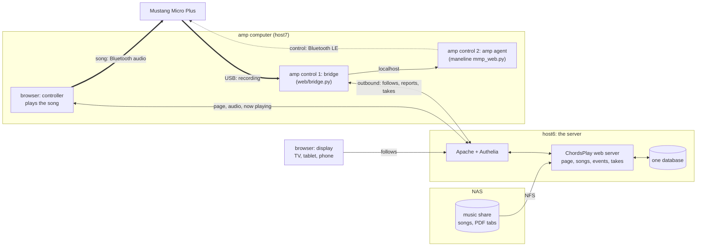
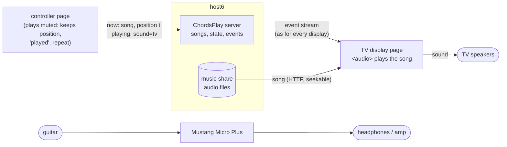

# ChordsPlay web app (version 1.0)

ChordsPlay in the browser: <https://example.org/chordsplay/> (Authelia login).
Plan and reasons: Trac page `ChordsPlay`. The Tk app stays usable. The page's own help (`?`)
says the same as the first sections here, in short.

## What you need for what

* **With any speaker, headphones or amp:** playing the songs, the chords as large as the
  screen allows, PDF tabs, choosing songs (filter), tags, the song on a TV, tablet or
  second screen. The sound comes out of the device the page runs on, so connect that to
  whatever you play through: headphones, a speaker, the AUX input of an amp, or a
  Mustang Micro Plus by Bluetooth.
* **Only with a Fender Mustang Micro Plus:** the guitar sound changing by itself per song
  (and within a song), equal loudness of all sounds, adjusting effects, keeping a sound
  in the amp, recording takes. For these, the computer the Mustang is connected to runs
  *amp control* (the amp bridge, set up once; see "Guitar tone").
* **With a separate guitar amp:** everything in the first point works; the guitar sound
  is set on that amp, ChordsPlay doesn't change it.
* **On another screen (TV, tablet, laptop):** only a browser. A link or QR code from `d`,
  or for your own TV a bookmark paired once (see "A TV or tablet as display").

## Using it

The page looks like the desktop app: the playlist on the left, the song's chords and
lyrics on the right, as large as the window allows (1–4 columns). The browser plays the
song, so connect the Mustang (or any output) to the device the browser runs on.

Most keys work as in the desktop app:

| Key | Action |
|---|---|
| Space, m | play / pause |
| Enter, n | next song |
| Backspace, p | previous song |
| 0 | back to the start of the song |
| + / −, → / ← | 1 s / 5 s forward or back |
| s | shuffle the playlist |
| f | filter dialog: same fields, saved filters and live count as in the desktop app |
| t | tags of the song; press a tag's key to switch it |
| l | show or hide the playlist |
| a / A | choose / switch the audio output (Chrome only) |
| d | show the song on a TV or tablet (display link, see below) |
| v / V | the song's text or one of its PDF tabs (cycles) / all PDFs and their songs |
| Page Down / Up | turn the PDF's pages |
| g | guitar tone: the amp's presets for this song (see below) |
| G | learn: the amp's current preset from here on (in the first 3 s: from the start) |
| F11 | full screen |
| ? | key overview |

Double-click a song in the list to play it; click a column heading to sort.
A song repeats until you go on, and each time it ends it counts as played (as in the
desktop app). The page remembers the song you were at, on every device: after a reload
press Space to go on. Hardware media keys and Bluetooth headset buttons work too
(play/pause, next, previous).

Browsers need one key press or tap before they play sound; after a reload the page
shows "Press Space to play".

**Long comment lines.** Chord sheets often carry comments in long lines ("Note: the
recorded version is 30 cents sharp ..."), and the widest line decides the font size.
The page shows such lines wrapped to the width of the song text whenever that makes the
text larger. Chord lines, the lines under them and tab lines are never changed, and
lines no longer than 90 % of the song's lines stay whole. Heuristic:
`ChordsPlay/textfit.py`.

**Not yet in the web app:** editing tones (the knobs; use the desktop app, tones are
shared through `web.migrate merge`), filter import/export to files.

## A TV or tablet as display

Press `d` (or *Display*). The dialog shows a link, its QR code and the short code in it.
Open the link on the TV's browser, a tablet on the music stand or a second screen: it
shows the song this page plays, as large as that screen allows, with its title, capo
and the time in the song, and follows every change within about a second. Click it,
or press Enter or OK on the remote, for full screen; it keeps the screen on.

* The display plays no sound and can change nothing; the audio stays on the controller
  (the device paired with the Mustang).
* A link is valid for 12 hours. *End all display links* stops every open display at once.
* Several displays can follow the same controller.
* The display follows the user, not the browser tab: whatever page of yours plays last
  is what the displays show.
* The display needs no login (a TV, a friend's TV): the code in the link is the key.
  Everything else under `/chordsplay/` still needs the Authelia login.
* **Your own TV, paired once:** open `https://example.org/chordsplay/d/tv/`
  on it and keep it as a bookmark. It shows a code: enter it with `d` under *Pair a TV*.
  The TV then keeps a token as a cookie and follows you whenever the bookmark is
  opened, no new link needed. *Pair a TV* lists the paired TVs; ✕ removes one (it has
  to pair again). A code is valid for 10 minutes and can only be approved by the
  logged-in page.

## Takes: recording yourself

`r` records a take of the playing song through the amp's USB output (stereo, 24 bit,
48 kHz, as the amp sends it), `r` again stops it; the top right shows `● REC 0:12`.
The amp bridge records on the computer the amp is connected to by USB, compresses
the take to Opus (192 kbit/s, about 4 MB for 3 minutes) and sends it to the server
(`~/.local/share/chordsplay-web/takes`, `CHORDSPLAY_TAKES_DIR`). `R` (or *Takes*) lists
the song's takes: ▶ plays one, ✕ deletes it. A take holds the **whole mix**: the amp
mixes the song arriving over Bluetooth into its USB output (measured 2026-11-10: −92.5 dBFS
with nothing playing, −41 dBFS with a song and the strings quiet). A take nobody stops ends after 20 minutes.

## PDF tabs

A song can show a PDF (a tab printed from Ultimate Guitar, your own sheet) instead of
its text, as large as the screen allows: the white margins and a browser's print
header and footer are cropped, and two pages stand side by side when they are nearly
as large as one alone.

* `v` cycles through the song's text and its PDFs; the choice is kept per song.
  *Page Down* / *Page Up* turn the pages; the title shows which pages you see.
* A display (key `d`) shows the same PDF and pages as the controller.
* **Where a tab belongs: next to its song**, like a hand-saved song text, with the song
  file's name and `.pdf`: `13 Cruz.mp3` → `13 Cruz.pdf`. A part goes after ` - `:
  `13 Cruz - Solo.pdf`. The library folders are always scanned for these.
* Other folders on host6 (`CHORDSPLAY_PDF_DIRS`, default `~/.local/share/chordsplay-web/pdf`):
  there a file named `Artist - Title.pdf` or
  `Artist - Title - Part.pdf` (`Queen - Hammer To Fall - Solo 1.pdf`) links itself to its
  song; case, punctuation and a leading "The" don't matter. `V` (or *PDF*) lists all PDFs: choose the song for one that didn't link
  itself, or mark it as no song's tab. A choice by hand is never changed by a later
  scan. The folders are scanned at start, every 24 hours and when `V` opens.

## Guitar tone (Mustang Micro Plus)

As in the desktop app, a song can switch the amp's preset at set times (cues): a quiet
intro, a loud chorus. Cues, artist presets and tones are in the central database, so
every device plays them.

* `g` (or *Tone*, or the amp status at the top right): the song's cues, the amp's 100
  presets (◀ = the current one) and the saved tones. *Try now* switches the amp without
  storing anything; *Save from start*, *Save from m:ss* (where the song is) and *Save for
  artist* store it. ▶ plays a cue from 2 s before, ✕ deletes it.
* **Level** (next to the presets): *original* plays the preset as stored in the amp. A
  number plays it **level-matched**: with the correction from your level measurement
  (`contrib/match-preset-levels.sh`), so every preset at *matched* (0 dB) is equally
  loud, plus −6 … +6 dB (e.g. +3 for a solo). It is stored with the cue, the artist
  preset and the preset per sound, and used by *Try now*. Level-matched presets play
  by audition on slot 100 (nothing is written to the amp); a preset that wasn't
  measured plays at its own volume plus the offset.
* **Knobs** (fold out under the presets): the chosen preset's amp gain and EQ, and per
  effect on/off, mix, depth, decay, feedback. With *Play while adjusting* every change
  is heard at once (by audition, nothing written to the amp). *Save …* stores the
  knobs with the cue or the artist, together with the level; ✎ in a cue's row loads
  it for changing, ⤓ stores the current choice into that cue. With *original* the
  preset keeps its own volume. The server knows each slot's preset from a backup
  (`python -m web.presets import BACKUP_DIR`) and asks the bridge to read a slot again
  when the amp's name for it changed.
* **Keep a tuned sound:** *Save as tone…* names it (preset, level, knobs); it is then in
  the *Tones* list for any song. *Write to amp slot…* writes it into a free slot of the
  amp (72–99), so the amp's own buttons call it up too: built exactly as it is heard by
  audition, read back after writing. The factory presets (1–71) and slot 100 (used for
  auditions) are never written. maneline's `mmp_restore.py` puts slots back from a backup.
* `G`: stores the preset the amp has now (chosen with its own buttons, say) from here on.
* The switching itself is done by the **amp bridge** on the computer the amp is paired
  with. It needs no open port: like a display it follows your session from outside.
  Set it up once on that computer (next to the amp agent of the desktop app):
  1. `g` → *Bridge link…*: copy the line into `~/.config/chordsplay/bridge.env`.
  2. `contrib/install-amp-bridge.sh` (from a checkout of this repo).
  It starts the amp agent while the amp is connected as an audio device, like the
  desktop app does. A new bridge link ends the previous one.
* The top right shows what the bridge reports: `amp 19 80S Rock`, `amp ▶ <tone>`,
  `amp idle · 19 80S Rock`, or `amp bridge offline` (nothing heard for 30 s). *Idle*: after
  5 minutes without a switch the agent drops the Bluetooth control link to save the amp's
  battery. Sound (Bluetooth audio, USB) is a separate connection and keeps playing; the
  next switch wakes the link, which takes a few seconds.
* **Suggested presets** for songs with no preset of their own and none for their artist:
  the local LLM on host6 puts each song into a sound (clean, crunch, hard rock, …; with
  the artist's genres from MusicBrainz as a hint) and says whether it knows the song.
  Suggestions are **only shown** until you tick *Play suggestions automatically* (under
  *Preset per sound*): the model claims to know nearly every song (98 % on 2026-11-10,
  album tracks of German singers included), so set the presets by ear first. Then songs
  it "knows" are switched; guesses never are. `g` shows the suggestion,
  with *Use from start* (store it as the song's own) and *Reject*. Under *Preset per
  sound* you set which preset each sound plays: the table starts as a draft by preset
  names and is meant to be set by ear. New songs get a suggestion after each library
  scan (`python -m web.suggest` runs it by hand). Order when a song plays: its own cues,
  the artist's preset, the suggestion, `AMP_DEFAULT_SLOT` of the bridge.
* The bridge switches only while a song plays. While the desktop app runs as well,
  both can switch the amp; use one at a time.

## How it works

### What runs where, and why



* **Server (host6):** one database for every device; scans the library, fetches chords,
  serves the page, the audio and the PDFs.
* **Controller:** any browser; with the Mustang it is the device paired with it, because
  the device that plays must send the sound to the Mustang.
* **Display:** any browser; shows only, needs no login (a link with a code, or a TV
  paired once).
* **Amp control** is two programs on the amp computer. The **amp agent** (maneline) holds
  the Mustang's single control connection, which needs a heartbeat every 0.5 s: only a
  program that always runs can do that, not a browser tab; the desktop app uses it too.
  The **bridge** (ChordsPlay) connects the agent with the web app: it follows your song
  from the server and tells the agent what to play, without an open port (it connects
  out, like a display), and records takes from the Mustang's USB.

```
browser (controller)  --https-->  Apache :443 /chordsplay/ (Authelia)  -->  web/app.py 127.0.0.1:8616 (host6)
                                                                              |-- ~/.local/share/chordsplay-web/chordsplay.db
                                                                              '-- music: /srv/music (NFS)
```

* `web/app.py` (Flask, served by waitress): JSON API, the page (`web/static/`), the audio
  files with range requests. All queries go through `ChordsPlay/db.py`, unchanged.
* One database for all devices: play history, tags, filters and the playlist order
  are no longer per device. It has the Tk app's schema plus a table `web_state`
  (the current song per user).
* The library scan and the Ultimate Guitar fetch run in the server (`ChordsPlay/scan.py`),
  at start and every 24 hours.
* User: Apache passes the Authelia name as `X-Remote-User` (and drops what a client
  sends). Requests through Apache without a login are refused. Direct requests on host6
  (`curl 127.0.0.1:8616`) use `CHORDSPLAY_USER`.
* Following: the controller reports song, position and play/pause (`PUT api/now`, at
  every change and every 15 s while playing). The server keeps the latest state per user
  in memory (and the song in `web_state`) and pushes it as server-sent events to
  `api/events` and `d/<code>/events`.
* Amp bridge (`web/bridge.py`, standard library plus `ChordsPlay/amp.py`): follows
  `d/bridge/<token>/events` (song and position; `plan` when cues were edited; `cmd` for
  *Try now*), fetches the song's cues (`d/bridge/<token>/song/<id>`), picks the cue with
  the desktop app's own logic (`AmpCues`, 0.3 s early) and switches through the agent
  (`AmpClient`). It reports the amp's state every 10 s or on a change
  (`PUT d/bridge/<token>/amp`), which the controller pages get as `amp` events. The
  token is stored only as a hash (table `bridge_tokens`, one per user). Display codes are in the table `display_codes`
  (10 characters from a 31-letter alphabet, ~49 bits; an unknown code costs a 1 s wait).
* Audio comes from the NFS mount, not from media-find as the plan suggested: the scanner
  needs the files anyway (tags), and no media-find service account is needed. The unit
  mounts the share if it is missing (the fstab entry has `users`).

## Possible, not built: the sound on the TV

Decided 2026-11-11 not to build it for now; recorded so it can be picked up later.

Today the device with this page plays the song, because it is the one paired with the
Mustang by Bluetooth; a display only shows. "Sound on the TV" would be a switch on the
controller (*Sound: here / on the TV*):



* The TV loads the same audio file as the controller (`d/tv/audio/<id>`, only the
  current song) and follows play/pause/song changes from the event stream. It computes
  where the controller is (`t` plus the time since `at`, corrected for the clock
  offset) and seeks when it is more than ~0.25 s off; the drift is small because both
  play the same file.
* The controller keeps playing, muted: its position stays the reference, and "played"
  and the repeat at the end work as before.
* Browsers start sound only after a key press on the device: the TV shows "Press OK to
  play the sound here" once.
* Consequences: the song no longer goes through the Mustang (you hear it from the TV, the
  guitar from the Mustang's headphones or an amp), and a take then holds only the
  guitar. The TV's delay (100–200 ms) doesn't matter, as with Bluetooth: the song isn't
  tied to the guitar's timing. Good for playing to the room or with friends; for
  practising with headphones the song through the Mustang stays better.

## Operating it (host6)

| What | How |
|---|---|
| Install / update | `contrib/install-web.sh` (copies the checkout to `~/.local/share/chordsplay-web/app`, venv, restarts the user unit `chordsplay-web.service`) |
| First database | `cd ~/.local/share/chordsplay-web/app && ../venv/bin/python -m web.migrate init ~/.chordsplay.py.db --central /opt/chordsplay-sync/chordsplay-central.db` |
| Add another host's history | copy its `~/.chordsplay.py.db` over (Tk app closed), then `../venv/bin/python -m web.migrate merge <file>`; plays, tags, saved filters, amp cues, artist presets, tones and level corrections are added, nothing twice (what the web DB has already wins). Songs locked there (tag x) bring their text: it replaces ours and goes to the sync service with its lock |
| Logs | `journalctl --user -u chordsplay-web` |
| Settings | `~/.config/chordsplay/web.env`: `CHORDSPLAY_USER_MAP=authelia=dbuser,...`, `CHORDSPLAY_SCAN_HOURS`, `CHORDSPLAY_SYNC_URL` + `CHORDSPLAY_SYNC_TOKEN` (push new chords to the old sync service, so the Tk apps get them) |
| Apache | `/etc/apache2/public.d/locations/chordsplay.conf` (= `contrib/apache-chordsplay-web.conf`, with `flushpackets=on` for the event streams) and `<Location "/chordsplay/">` in `/etc/apache2/homeauth.conf` |
| Displays and amp bridge without login | `<Location "/chordsplay/d/">` with `AuthType None` / `Require all granted` after the `/chordsplay/` block in `homeauth.conf` (since 2026-11-10). Everything below `/d/` needs a display code (read only) or the bridge token (follow the session, report the amp's state); the app serves nothing else there. |
| After a Mustang firmware update | on the amp computer: `cd ~/.local/share/chordsplay/maneline/scripts && ~/.local/share/chordsplay/maneline-venv/bin/python mmp_check.py ~/.local/share/chordsplay/levels/backup-20261110-221319 --all` (connection, firmware against the backup, names, presets, switching, audition; `--write` also saving on slot 99, put back at the end) |
| Amp bridge (amp computer) | `contrib/install-amp-bridge.sh`; unit `chordsplay-amp-bridge.service`, logs `journalctl --user -u chordsplay-amp-bridge`; stop it before `contrib/match-preset-levels.sh` |

## Tests

```bash
python3 -m venv /tmp/wv && /tmp/wv/bin/pip install -r web/requirements.txt
/tmp/wv/bin/python -m unittest discover -s tests     # test_web.py is skipped without Flask
```

`tests/test_textfit.py` covers the comment wrapping, `tests/test_web.py` the API (filter,
order, saved filters, song text, audio ranges, played, tags, current song, proxy login),
the displays (code, state, event stream, unknown and ended codes, no way from `/d/` to the
controller API, QR code, hub wake-up), the amp (cues, artist preset, learn, bridge token,
the bridge playing cues, edits, *Try now* with slot and tone, nothing while paused) and the
migration (plays, tags, cues, tones and levels merged once, newer central chords win).

Manual check in a browser (headless Chromium with Playwright did this for 0.1): play,
pause, next/previous, filter with live count and regex errors, tags by key, played count
after the end, 1600×900, 1920×1080 and 390×844 layouts, reload resumes. For 0.2 also a
controller and a display page side by side: the display follows next/pause/play within a
second, shows the expired message after *End all display links* (open display: ~8 s).
